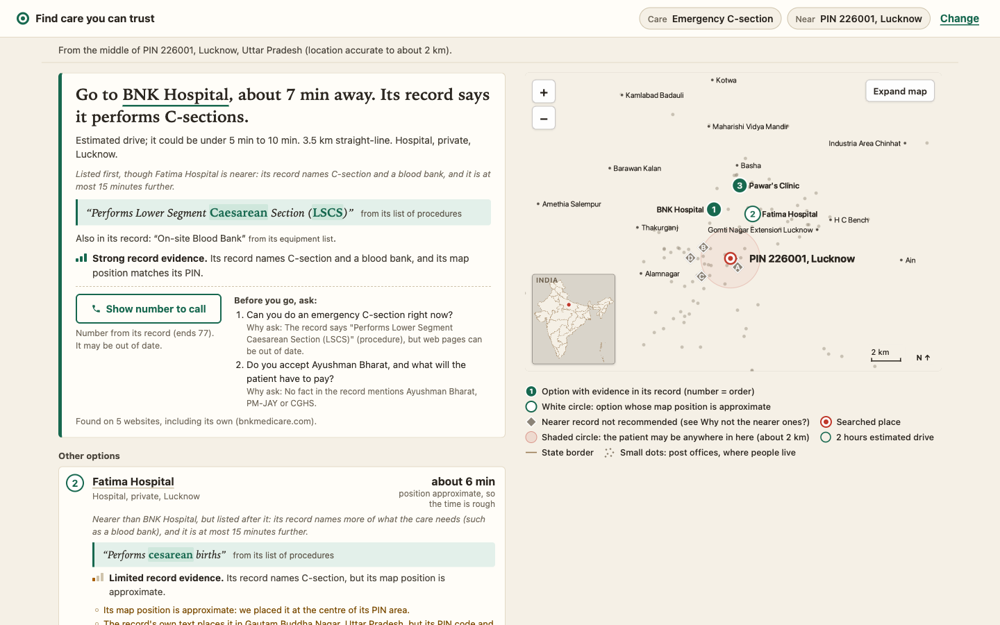
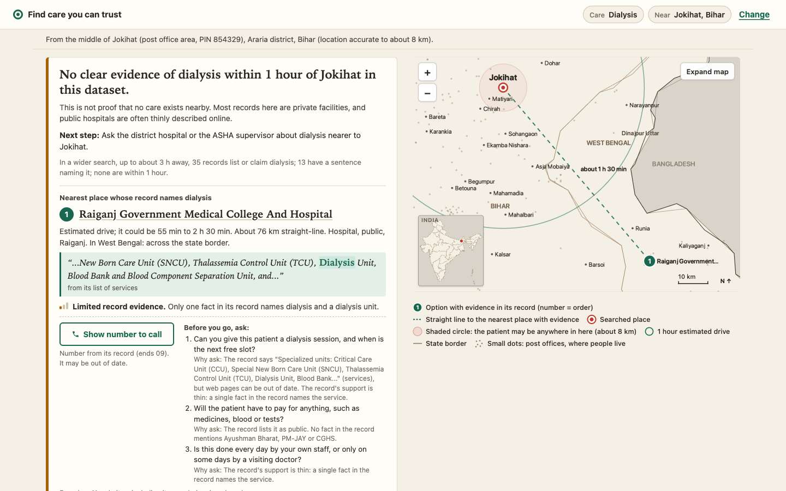
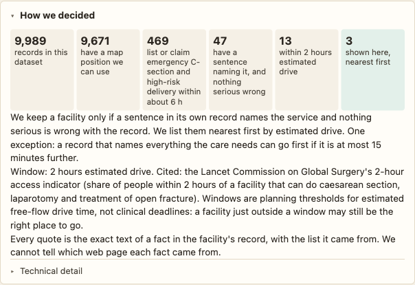
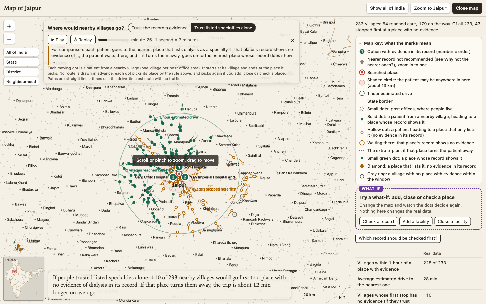

# Find care you can trust

A care finder for India, built for the CMU Datathon (Fall 2026) on the Virtue Foundation facility dataset. Hruday Nara, with Claude Code agents.

You choose a service (emergency C-section, dialysis, NICU, trauma, MRI and seven more, or free text) and a place (a PIN, town, district or coordinates). The tool returns up to three facilities whose own records show they offer it, nearest first by estimated drive time. Every claim on a card quotes the facility's own text. When no record nearby shows the service, it says so plainly and points to the nearest place that does, instead of presenting a weak match as an answer.

It runs as a Databricks App on Databricks Free Edition: https://vf-care-finder-7474645226493940.aws.databricksapps.com. Access is limited to the owner's Databricks workspace, because the reuse terms of the facility data have not been checked (see "Data and terms"), so a reader outside it gets a login page. The video shows the app running live, and the steps below rebuild it locally.

Who checked what: the gold fact set, the trust-check reviews, the tagger reads and the outside-list link checks were made by AI agents (Claude), not by people. AI models judged the evaluation. A 40-item human check of those judges is prepared and not done yet.

## Why it exists

The facility table was compiled from web pages, and a specialty label is not evidence. 4,489 records list obstetrics as a specialty; only 418 of them have a sentence naming a caesarean section (432 records name one in all). A query that filters on the specialty label looks complete and is usually wrong: on a sealed test of 140 queries at 60 random post offices, its top pick's record clearly showed the service in 23 of 115 answers (20%). Our ranker's did in 90 of 101 (89%). Details and caveats are in [reports/methods_and_limits.md](reports/methods_and_limits.md).

## What it looks like

An answer: the nearest facility whose record shows the service, the quote that shows it, how strong the evidence is, and what to ask before you go.



No clear evidence nearby: the tool says so, explains that this is not proof that no care exists, and shows the nearest place with evidence, across a state border if needed.



"How we decided" shows the funnel from every record to the cards, and the rule in plain words.



The map simulates where patients from nearby villages would go if they trusted listed specialties alone, compared with trusting the record's evidence. What-if tools let you check, add or close a facility and watch the choices change. It is a deterministic illustration, not a forecast.



More screenshots, phone views included, are in `reports/figures/ui/final_*.png`.

## What we propose

Each proposal rests on a number measured in this project; the sources are in [reports/methods_and_limits.md](reports/methods_and_limits.md).

1. **Referral lists should filter on cited evidence, not specialty labels.** On the sealed test the specialty filter's top pick clearly showed the service in 20% of its answers; picks that had to quote a sentence naming the service did in 89% (our ranker) and 84% (any fact names it). A referral desk or helpline can apply the same rule with no model: require a quoted sentence, then sort by distance.
2. **Data collectors should record blood availability with every C-section claim.** 373 of the 432 records that name a caesarean section have no fact about blood. Until they do, the card turns that gap into a question to ask by phone.
3. **Virtue Foundation can choose verification calls by reach.** "Which record should be checked first?" in the app finds the one check that would bring the most nearby villages within the window of evidence-backed care. A call that confirms one record helps more people than a call chosen at random.
4. **Government lists should be joined, not trusted blindly.** The automatic name matcher linked LaQshya certificates to the right record only 55% of the time; only the 63 links an agent confirmed show on cards. A shared facility identifier across registries would remove this step.

These are proposals from a decision aid, not results of a field trial.

## How it decides

1. **Read each fact.** Every sentence in a record gets evidence tags (24 in all, such as `csection`, `blood`, `dialysis_unit`) from hand-written patterns on 20 tags and small trained models on 4. A model replaced the patterns on a tag only where it beat them on a held-out, agent-labeled gold set and an agent's read of the texts where the two disagree (see [methods](reports/methods_and_limits.md) for both ship rules and their weak spots).
2. **Grade each service.** Rules turn tags into a grade per facility and service: 0 none, 1 claimed (a label only), 2 supported (a sentence names the service), 3 corroborated. The rules follow published standards (WHO emergency obstetric signal functions, India's newborn care guidelines, PM-JAY empanelment criteria, the national dialysis programme).
3. **Check each record.** Trust checks flag location conflicts, records that merge several hospitals, implausible claims and duplicates. A major flag blocks the service line.
4. **Find the place.** The resolver turns what you typed into a point and states its precision. An ambiguous name (Aurangabad is in Bihar and in Maharashtra) asks you to choose.
5. **Filter and order.** Keep grade 2 or higher, no major flag, and an estimated drive time inside the service's window (for example 120 minutes for emergency C-section, after the Lancet Commission's 2-hour indicator; 60 for dialysis). List nearest first; a better-evidenced facility may go first if it is at most 15 minutes further.
6. **Explain.** Cards are built from templates and exact quotes. No language model writes text on a card. Each card lists questions to ask by phone, because a web record can be out of date.

Outside lists (LaQshya maternity certificates, AERB radiotherapy licences, the National Cancer Grid) add dated, cited lines to matching cards and a separate lane of listed facilities not matched to any record. They never make a facility recommendable on their own.

What we do not claim: no probabilities, no "there is no care here", drive times are free-flow estimates from straight-line distance, and windows are planning thresholds rather than clinical deadlines. The full list is in [reports/methods_and_limits.md](reports/methods_and_limits.md).

## Run it locally

You need the source tables, which are not in this repository (see "Data and terms" below).

1. Get the data. Add the Databricks Marketplace listing "Virtue Foundation Dataset (DAIS 2026)" to a workspace, export its tables as CSV into `data/raw/` as described in [data/README.md](data/README.md), then check them:

   ```bash
   python -m venv .venv && .venv/bin/pip install -e ".[dev]"
   .venv/bin/python scripts/verify_data.py
   ```

2. Build the pipeline outputs and the app bundle. Each script prints a short summary.

   ```bash
   .venv/bin/python scripts/wp1_silver_facilities.py   # clean facilities and facts
   .venv/bin/python scripts/wp2_geography_nfhs.py      # post offices and PIN points
   .venv/bin/python scripts/wp2_places.py              # place gazetteer for the resolver
   .venv/bin/python scripts/wp3_regex_baseline.py      # evidence tags and grades (patterns)
   .venv/bin/python scripts/wp3_regrade_v03.py         # standards-aligned grades (recipe v0.3)
   .venv/bin/python scripts/wp11_trust_checks.py --no-scenarios   # trust flags
   .venv/bin/python scripts/wp12_bundle.py             # dbapp/bundle and dbapp/vf
   ```

   The trained tagger models, the LLM labels and the agent-checked outside-list links are not in the repository. Without them the bundle uses pattern tags on every tag and carries no outside-list lines, so answers can differ slightly from the deployed build; the bundle's `manifest.json` records what was missing.

3. Start the app and open the address it prints:

   ```bash
   cd dbapp && ../.venv/bin/python server.py
   ```

   To work on the front end, run `pnpm install` and `pnpm dev` in `app/` with the server running; `pnpm build` writes the built page to `dbapp/static/`. See [app/README.md](app/README.md).

4. Tests: `.venv/bin/pytest -q`.

## Deploy on Databricks Free Edition

The full steps, with the checks to run after each, are in [dbapp/README.md](dbapp/README.md). In short:

1. Install the Databricks CLI and log in: `databricks auth login --host <your workspace URL>`.
2. Build the bundle locally: `.venv/bin/python scripts/wp12_bundle.py`. Databricks Apps refuse any file over 10 MB; the script splits the keyword index and fails if any file is too large. `wp12_bundle.py --check` verifies the full build (versions, required files including the outside lists, file sizes, no call number in clear) and will name anything a partial rebuild lacks.
3. Stage and upload the app folder, then deploy:

   ```bash
   ME=$(databricks current-user me -o json | jq -r .userName)
   .venv/bin/python scripts/wp12_bundle.py --stage /tmp/vf_app
   databricks workspace import-dir /tmp/vf_app "/Workspace/Users/$ME/vf-care-finder"
   databricks apps create vf-care-finder        # first time only
   databricks apps deploy vf-care-finder --source-code-path "/Workspace/Users/$ME/vf-care-finder"
   databricks apps get vf-care-finder -o json | jq '{url, app_status, compute_status}'
   ```

4. Open the URL (workspace login required) and check that `/api/health` reports `mode: bundle`.

`notebooks/01_pipeline.py` runs an earlier version of the pipeline (the WP4 tagger, before the round-2 encoder) on serverless compute against the Marketplace tables and writes Delta tables. It matched the local counts on that earlier build; the deployed bundle was built locally with the steps above.

Free Edition limits that matter: serverless compute only, a few apps per account, and an app stops 24 hours after it was last started or deployed. Restart it (`databricks apps stop`, then `start`) shortly before anyone uses it. Keep the app's permissions inside your workspace; see "Data and terms".

## Repository map

```
dbapp/        the deployed Databricks App: FastAPI server, built front end, app.yaml; bundle/ and vf/ are generated
app/          front end source (Vite, TypeScript, deck.gl): answer cards, map, trip simulator
src/vf/       the tested core: loading (io), cleaning, recipes and grades, trust checks, resolver (locate),
              drive time (travel), ranking (rank), why-not, outside lists, questions to ask
scripts/      one rerunnable script per step: wp1 to wp13, the bundle (wp12), the sealed evaluation, findings
notebooks/    01_pipeline.py, the pipeline as a Databricks notebook
reference/    drive-time state factors and the post offices that fall in the sea
sql/          the profiling queries and the obvious specialty-filter query used for comparison
tests/        unit and integration tests
reports/      methods and limits, evaluation results, model and trust reports, findings.json, figures
docs/         brief, data dictionary and profile, recipes, data contracts, decisions log, explainer
tasks/        the work packages and status board used to build it
data/         raw, silver, gold, labels and models; only README.md, MANIFEST.json and the gold fact set are versioned
```

The numbers in the results reports, this README and the video script come from `reports/findings.json`, built by `scripts/wp9_findings.py` from the frozen bundle and the evaluation files; `wp9_findings.py --check FILE` fails on any number not found there.

## Credits

- Data: Virtue Foundation, with the pipeline that scraped and consolidated the records built by Databricks; shared as the Databricks Marketplace listing "Virtue Foundation Dataset (DAIS 2026)". India Post PIN code directory.
- Outside lists, shown as cited facts with acknowledgement: LaQshya certification lists (NHSRC, Ministry of Health and Family Welfare), AERB radiotherapy licences (Atomic Energy Regulatory Board), National Cancer Grid member list.
- Standards the recipes cite: WHO 2009 emergency obstetric care handbook, India's facility-based newborn care guidelines (FBNC 2025), PM-JAY empanelment criteria, the Pradhan Mantri National Dialysis Programme, and the Lancet Commission on Global Surgery's 2-hour access indicator.
- Drive-time fit: OSRM routes on OpenStreetMap data. Country outline: Natural Earth. Encoder: BAAI bge-small. Teacher labels and evaluation judges: Anthropic Claude models.
- Built with Claude Code.

## Data and terms

- **No raw data is in this repository,** and none should be added. The facilities table came from a Databricks Marketplace listing whose reuse terms have not been checked, so it is not republished here, and the app is shared only inside the owner's Databricks workspace.
- The India Post PIN directory is published under the Government Open Data License, India.
- Outside lists are used only as derived facts (source, what the list says, its date, a citation), never as tables. The separate "also on lists nearby" lane uses only lists whose terms allow reuse with acknowledgement (LaQshya, AERB). Lists marked "all rights reserved" or needing permission are not shown as lane rows, and sites whose robots.txt disallows AI agents were not fetched.
- Call numbers shown in the app come from the facility records, are masked until a user asks to call, and may be out of date.
- This is a decision aid built on web-compiled records, not medical advice. In an emergency, call 108 (ambulance) or 102 (maternal transport).
