# Exploratory analysis of the raw data

Exploratory data analysis (EDA) is the step before cleaning rules and models: you learn what the data is, what one row means, and where it will mislead you. The usual order is (1) profile each table: rows, columns, how full each column is; (2) check the grain and the joins: what one row stands for, and whether a join multiplies rows; (3) look at one variable at a time: distributions, outliers, impossible values; (4) look at relationships between variables; (5) write down every trap the moment you find it, so the next step does not rediscover it. In this dataset that meant: the facilities table is one row per facility but 11 rows are exact duplicates; the PIN directory is one row per post office, not per PIN, so joining on PIN fans out; NFHS is one row per district with its own spellings; and the literal string `null` means missing, so `notna()` is true everywhere. Each section below answers one question with one figure, says how the numbers were computed (with the pandas operations, so you can redo them in a notebook), what the figure shows, the caveat, and what it means for the project.

How to rerun: `.venv/bin/python scripts/eda_raw_figures.py` (this run took 11 seconds). The script reads the raw files through `vf.io`, draws the twelve figures in `reports/figures/`, writes every number to `reports/figures/eda_stats.json`, and writes this file from those numbers. Figures use the shared style in `src/vf/plotstyle.py`.

Inputs: 10,088 raw facility rows, of which 88 are junk fragments and 11 are exact duplicate rows, leaving 9,989 facilities (30 truncated, with no facts or coordinates); 165,627 post offices; 706 NFHS-5 districts. Generated 2026-11-21T20:07:08+00:00 at commit `369e7af`.

## 1. What is in the facilities table?

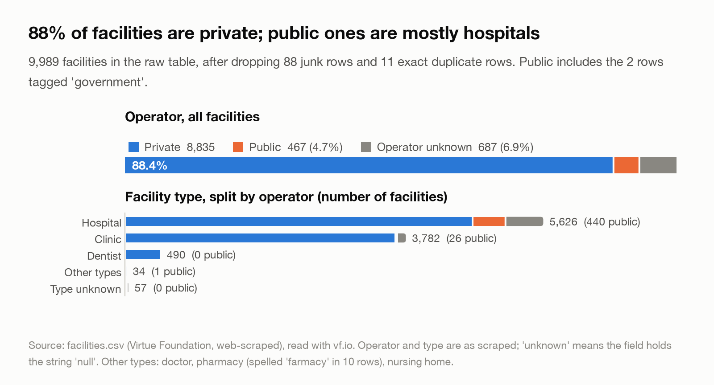

**Question.** What kinds of facilities are listed, and who runs them?

**How.** `io.read_facilities()` drops the junk rows, then `drop_duplicates("unique_id")` removes the exact duplicates. Operator and type are cleaned by turning the string `null` into a missing value (`Series.where(~s.map(io.is_null))`) and mapping `government` to public. `pd.crosstab(fac.ftype, fac.op)` counts type by operator.

**What it shows.** 8,835 facilities are private (88.4%), 467 public (4.7%) and 687 have no operator (6.9%). There are 5,626 hospitals, 3,782 clinics and 490 dentists. 440 of the 467 public facilities (94.2%) are hospitals; only 26 clinics are public (0.7% of clinics).

**Caveat.** Operator is as scraped. The 687 facilities with no operator could be either kind.

**For the project.** The public primary-care layer barely appears. Any access measure built on this table will understate public care, which is the data-desert half of the thesis.

## 2. Where are the facilities, compared with where people are?

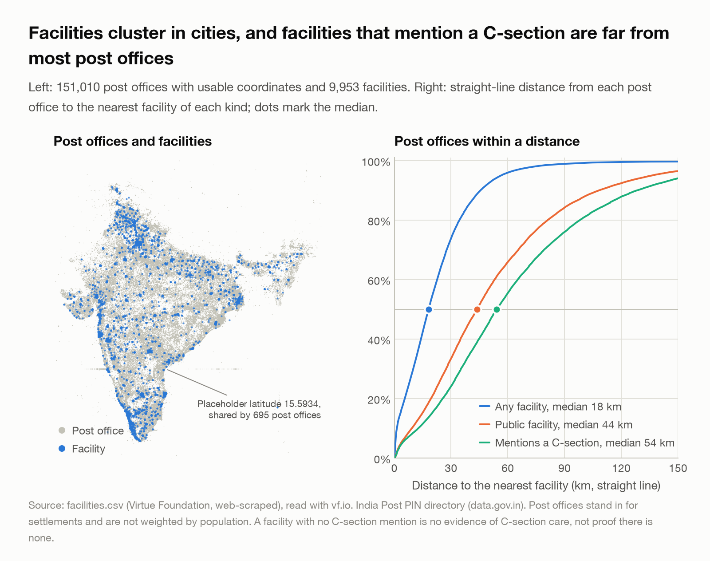

**Question.** Do facilities sit where people live, and how far is the nearest one?

**How.** Post-office coordinates are parsed with `io.to_float` and kept only inside the India bounding box (`io.in_india`): 151,010 of 165,627 (12,007 are the string `NA`). For each post office, `sklearn.neighbors.BallTree(metric="haversine").query(k=1)` finds the nearest facility; `np.median` and `(d > 30).mean()` summarise the distances. "Mentions a C-section" uses the recipe v0 regex over the facility's facts (section 4).

**What it shows.** The median post office is 18.1 km from the nearest facility of any kind, and 26.1% are more than 30 km away. For a public facility the median is 43.7 km (66.6% beyond 30 km). For a facility whose facts mention a C-section (443 with coordinates) the median is 54.0 km, 75.9% are beyond 30 km and 44.5% beyond 60 km.

**Caveat.** Post offices stand in for settlements and are not weighted by population; distances are straight lines. A facility without a C-section mention is no evidence of C-section care, not proof there is none. The bounding box is not enough to clean the post offices: 695 share the placeholder latitude 15.5934 across 5 states and 20 districts (the horizontal streak on the map), 1,085 sit more than 8 degrees from their own state's median position, and up to 348 post offices share one identical coordinate pair.

**For the project.** This is a preview of WP5. The jump from "any facility" to "evidence of C-sections" is the core of the story. WP2 should flag the placeholder latitude and the far-from-state points before WP5 computes distances.

## 3. How many facilities does each district have?

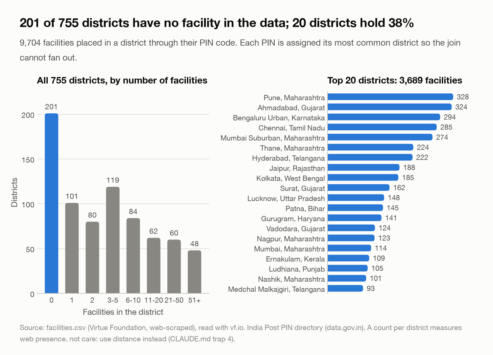

**Question.** How are facilities spread across districts, and how many districts have none?

**How.** PIN codes are cleaned with `str.replace(r"\s", "")` and kept if `str.fullmatch(r"\d{6}")`. In the PIN directory, `groupby(["pincode", "statename", "district"]).size()`, sorted by count, then `drop_duplicates("pincode")` keeps each PIN's most common district. Joining facilities on that one-row-per-PIN table cannot fan out. `groupby(district).size().reindex(all_755_districts, fill_value=0)` counts per district; the `reindex` is what makes the empty districts appear as zeros instead of disappearing.

**What it shows.** 9,704 of 9,989 facilities land in a district (9,915 have a 6-digit PIN; 211 of those PINs are not in the directory). 201 of 755 districts have no facility, and 101 have exactly one. Among districts with at least one, the median is 5. The top 20 districts hold 3,689 facilities (38.0%), led by Pune 328, Ahmadabad 324, Bengaluru Urban 294; 35 districts hold half of all placed facilities. Empty districts cluster in Arunachal Pradesh 22, Madhya Pradesh 19, Chhattisgarh 14, Telangana 14, Manipur 13, Odisha 12.

**Caveat.** 1,478 PINs span more than one district, so the most-common-district rule misplaces some facilities. Without stripping spaces inside PIN codes the same join places 9,559 facilities and leaves 202 districts empty, which is the method behind the figure in `docs/03_data_profile.md`; stripping recovers PINs written like "411 001".

**For the project.** A count per district measures web presence, not care (CLAUDE.md trap 4). It is the reason the plan uses distance from post offices instead.

## 4. Do claims match evidence?

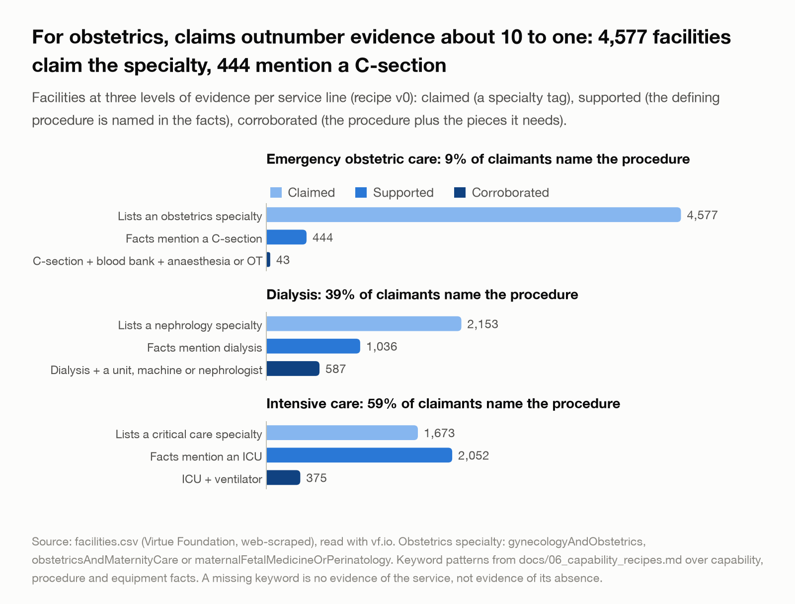

**Question.** When a facility lists a specialty, do its facts name the procedure that specialty implies?

**How.** `io.parse_list(v, dedupe=True)` turns each specialties cell into a deduplicated list; a claim is a non-empty set intersection with the specialty names. Facts from capability, procedure and equipment are exploded to one row per fact (`explode`), lowercased, joined per facility (`groupby("fac_idx").agg(" \n ".join)`), and searched with `str.contains(pattern)` for each recipe v0 regex. Every count is the `sum()` of a boolean column.

**What it shows.** Obstetrics: 4,577 facilities list an obstetrics specialty, 444 mention a C-section (10.3 claims per mention), and 429 do both, so 9.4% of claimants name the procedure. Only 43 facilities mention a C-section, a blood bank, and anaesthesia or an operating theatre together. Dialysis: 2,153 claim nephrology, 1,036 mention dialysis (38.6% of claimants), 587 also name a unit, machine or nephrologist. Intensive care runs the other way: 2,052 mention an ICU but only 1,673 list critical care, and 375 mention a ventilator too. The median facility lists 10 distinct specialties (hospitals 14), so specialty tags are cheap.

**Caveat.** The regexes are crude: they miss negations ("no ICU") and some patterns match unrelated text. Before removing the duplicate rows the obstetrics claim count is 4,585, the figure in `docs/03_data_profile.md`; that profile also searched the description, which this script leaves out because tags are defined on facts.

**For the project.** This is the "claims are not evidence" finding. Obstetrics has the biggest gap and only 43 corroborated facilities, so grading choices in WP3 and WP4 will drive the access maps. Model A has to beat these regexes at spotting C-section, blood and anaesthesia evidence.

## 5. How noisy are the facts?

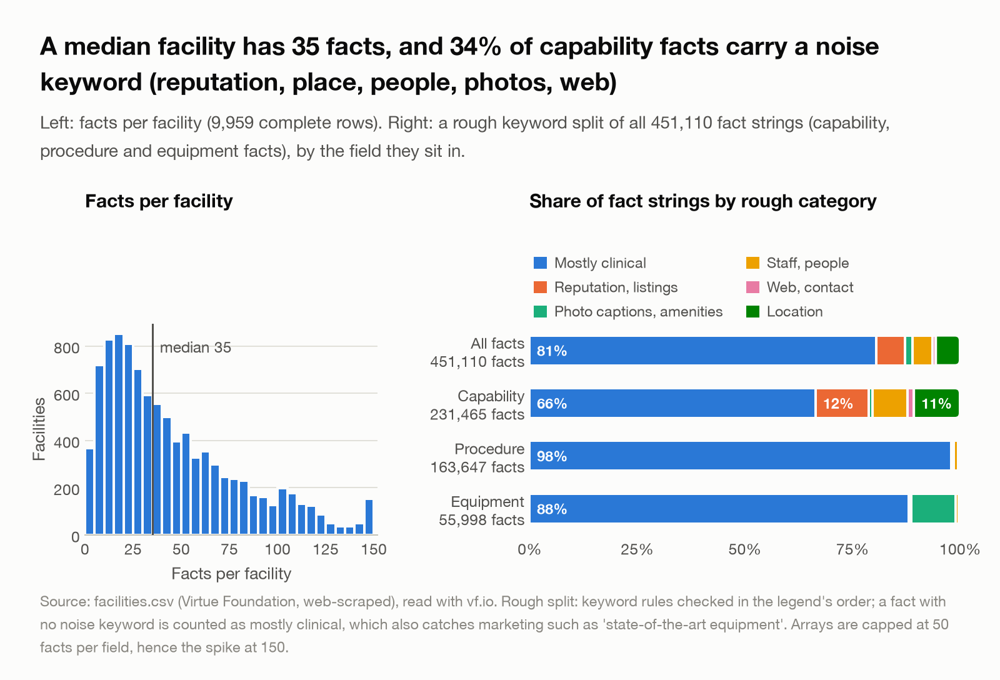

**Question.** How many facts does a facility have, and how many of them describe care?

**How.** Facts per facility is `map(len)` on the parsed lists, summed over the three fields, drawn with `np.histogram`. The rough split checks keyword patterns in a fixed order (reputation and listings, photo captions and amenities, staff and people, web and contact, location) with `str.contains` on lowercased text; each fact takes the first category it matches (`hit & ~done`), and anything left is "no noise keyword". `pd.crosstab(field, category, normalize="index")` gives the shares.

**What it shows.** There are 451,110 fact strings (capability 231,465, procedure 163,647, equipment 55,998), of which 275,097 are distinct after lowercasing. The median facility has 35 facts and the 90th percentile 101. Each field is capped at 50 facts, so no facility exceeds 150; 1,788 facilities hit the cap in at least one field. 33.6% of capability facts carry a noise keyword: reputation and listings 12.4%, location 10.7%, staff 8.1%. Procedure facts are 98.0% free of noise keywords. In equipment, 10.3% look like photo captions or amenities ("wheelchair accessible washroom").

**Caveat.** This is rough by design. Keyword rules make false hits ("NABL-certified blood test laboratory" counts as reputation) and miss marketing such as "state-of-the-art equipment", which lands in the clinical share.

**For the project.** Model A must learn to ignore 34% of capability facts; procedure facts are the cleanest evidence. Facilities at the 50-fact cap may have lost facts, so "no evidence" is a little more likely for large facilities.

## 6. Which columns can an analyst rely on?

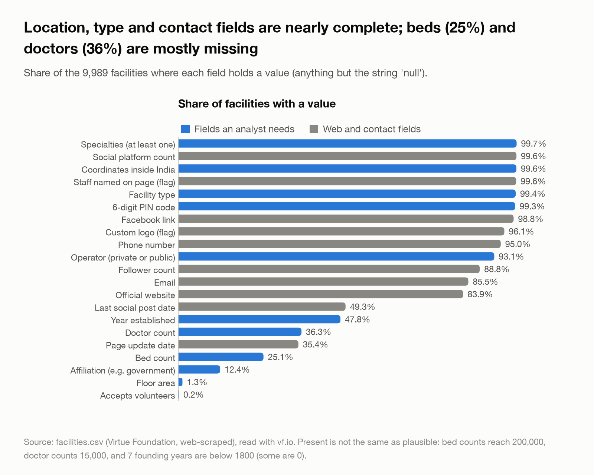

**Question.** How full are the fields an analyst would want?

**How.** For each column, `(~df[col].map(io.is_null)).sum()`, because `df[col].notna()` is true for every cell when missing is the string `null` (trap 2). Plausibility uses `io.to_float` and simple ranges.

**What it shows.** Location and type are nearly complete: coordinates inside India 99.6%, facility type 99.4%, 6-digit PIN 99.3%, operator 93.1%. Size is mostly missing: year established 47.8%, doctor count 36.3%, bed count 25.1%, floor area 1.3%. Contact fields are mostly filled: Facebook link 98.8%, phone 95.0%, official website 83.9%.

**Caveat.** Present is not plausible. Bed counts reach 200,000 (14 values are 0 or above 5,000), doctor counts reach 15,000 (15 values are 0 or above 5,000), and 7 founding years are below 1800, the lowest 0. The 5,000 and 1800 cut-offs are judgement calls.

**For the project.** Beds and doctors cannot weight access or feed a model for most facilities. Facility type and evidence tags are the usable descriptors.

## 7. Where do the facts come from?

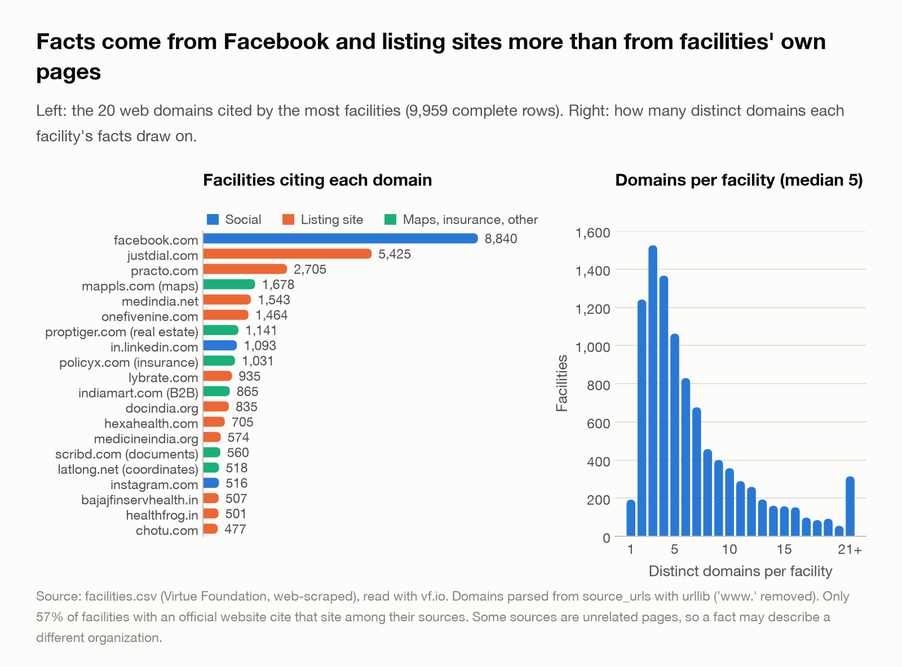

**Question.** Which websites do the facts come from, and how many independent sources does each facility have?

**How.** `io.parse_list` on `source_urls`, then `urllib.parse.urlparse(url).hostname` with `www.` removed, collected into a set per facility. `collections.Counter` over those per-facility sets counts each facility once per domain. The top 20 domains were classified by hand into social, listing site, and other.

**What it shows.** 158,444 URLs, all of which parse to a host. The median facility cites 8 URLs from 5 distinct domains; 192 facilities rely on one domain and 4,573 on six or more. facebook.com is cited by 8,840 facilities, justdial.com by 5,425 and practo.com by 2,705. Sites that are not about care are common: mappls.com 1,678, proptiger.com 1,141, policyx.com 1,031, indiamart.com 865 (maps, real estate, insurance, B2B listings). 3,895 facilities (39.1%) cite at least one of the 6 such domains in the top 20. Of the 8,355 facilities with an official website, 4,734 (56.7%) cite that site among their sources.

**Caveat.** `docs/02_data_dictionary.md` reports a different distinct-domain distribution and many URLs with no parseable domain; here every URL parses, so the earlier parser (SQL) likely counted an empty domain. WP1 should use `urlparse`. The classification of domains is mine and covers only the top 20.

**For the project.** "Number of distinct domains" overstates corroboration, because listing sites copy each other and some sources are about other things (real estate, maps, insurance). Source confidence should reward the facility's own site and penalise unrelated domains.

## 8. How do institutional births vary across districts?

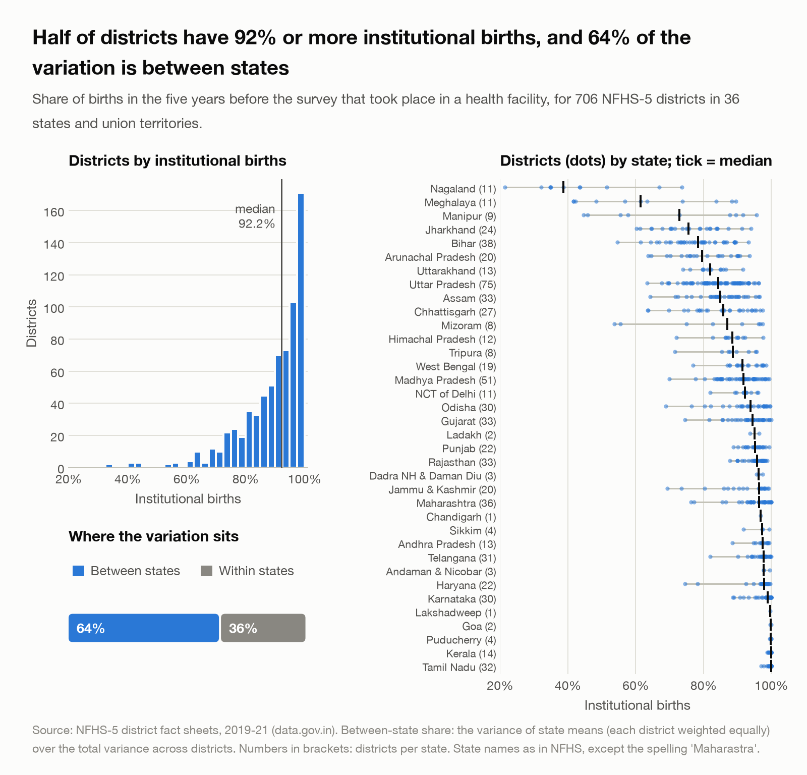

**Question.** What does the main outcome look like, and does it vary more within states or between them?

**How.** Every NFHS cell goes through `io.parse_nfhs_value`, which returns a value and a flag. `describe()` and `np.histogram` give the distribution. The between-state share is a one-way variance split: `groupby("state").transform("mean")` gives each district its state mean, and the between share is the sum of squared deviations of those means from the overall mean divided by the total sum of squares.

**What it shows.** The median district has 92.2% institutional births and the mean is 88.7%; the lowest is 21.4% (Mon, Nagaland). 125 districts are below 80% and 274 are at 95% or more. 63.8% of the variation is between states. The lowest state medians are Nagaland 38.7%, Meghalaya 61.5%, Manipur 72.9%, Jharkhand 75.6%. The widest spreads within a state are Nagaland 52 points, Manipur 51 points, Meghalaya 48 points.

**Caveat.** The outcome is bunched against a ceiling of 100%, so most districts differ by a few points. All 706 values are plain numbers (no flags). In the raw file 1 state value has a leading space and Maharashtra is spelled "Maharastra".

**For the project.** Model B needs cross-validation grouped by state (the plan already says so), and a "better than expected" district should be judged against its state. Modelling the shortfall from 100% may behave better than the raw percentage.

## 9. What predicts institutional births?

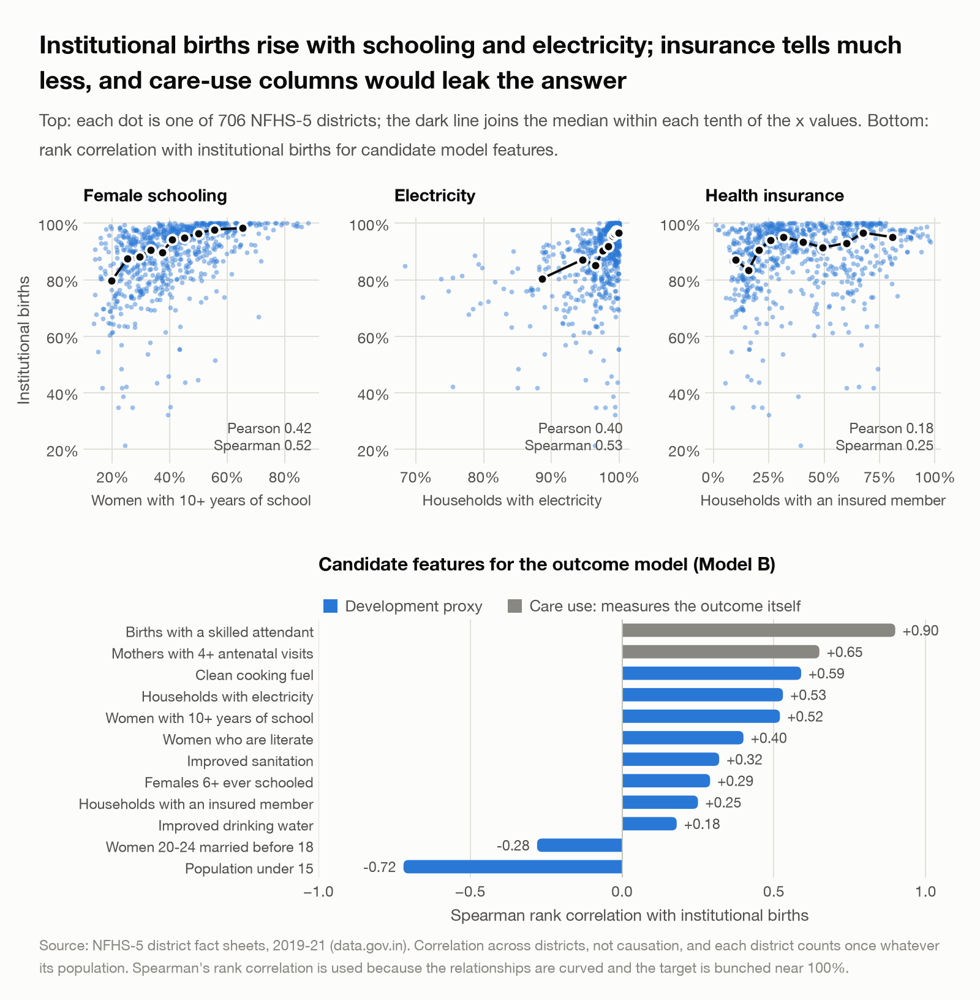

**Question.** Which district characteristics move with institutional births, as a preview of Model B's features?

**How.** `Series.corr(method="pearson")` and `Series.corr(method="spearman")` across districts. The dark line in each scatter is a binned median: `pd.qcut(x, 10)` splits districts into tenths by the x value, then `groupby(bin).median()`.

**What it shows.** Women with 10+ years of school: Pearson 0.42, Spearman 0.52. Household electricity: Pearson 0.40, Spearman 0.53. Health insurance: Pearson 0.18, Spearman 0.25. The strongest positive development proxy is clean cooking fuel (Spearman 0.59); the strongest overall is the share of the population under 15 (Spearman -0.72), a marker of high fertility. Two care-use columns correlate more: births with a skilled attendant (0.90) and 4+ antenatal visits (0.65).

**Caveat.** These are correlations across districts, not causes, and every district counts once whatever its population. Electricity is at 90% or more in 656 of 706 districts (median 98.7%), so it separates only the low tail.

**For the project.** Development proxies carry moderate signal, enough for a ridge baseline. Skilled attendance is nearly the target itself and antenatal visits are care use, so both would leak the answer and should stay out of Model B.

## 10. How big is the public-care blind spot?

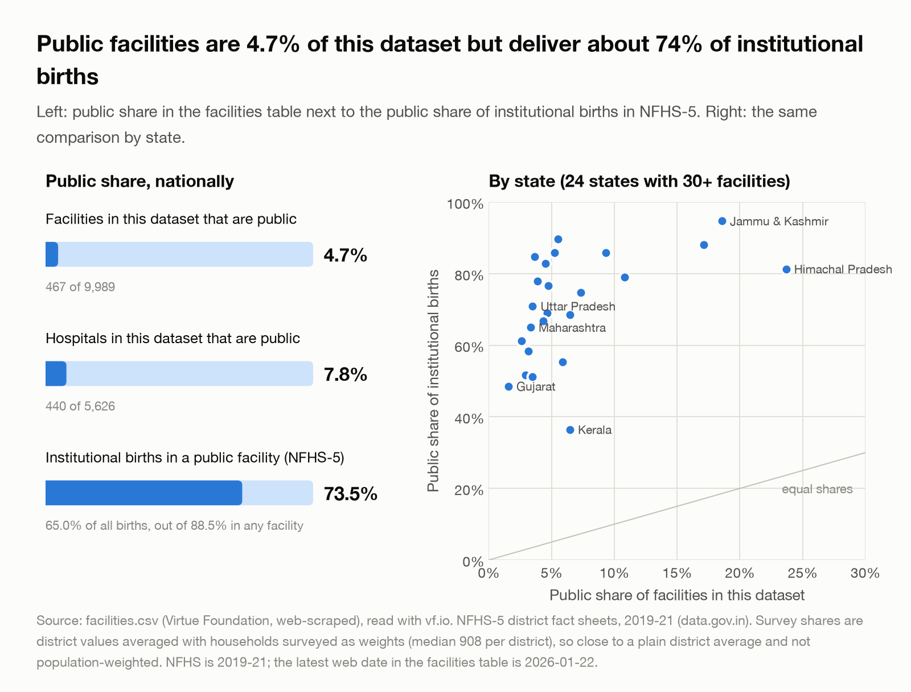

**Question.** How does the public share of facilities in this dataset compare with the public share of real births?

**How.** Dataset side: `(fac.op == "public").mean()`. Survey side: `np.average(col, weights=households_surveyed)` for institutional births and for births in a public facility. The NFHS public-facility column is a share of all births (it never exceeds institutional births, which the script checks), so dividing the two gives the public share of institutional births. By state: facilities get a state from their PIN's district, names are normalised (`str.upper`, `&` to AND, two spelling fixes), then `groupby` state.

**What it shows.** 4.7% of facilities in the dataset are public (467 of 9,989; 5.0% of those with a known operator), and 7.8% of hospitals. In NFHS-5, 65.0% of births happened in a public facility and 88.5% in any facility, so public facilities delivered 73.5% of institutional births (73.2% unweighted). In all 24 states with at least 30 facilities, the survey's public share is above the dataset's, by at least 30 percentage points (Kerala). The highest dataset share is Himachal Pradesh at 23.7%. The lowest survey share is Kerala, where public facilities deliver 36.5% of institutional births, still well above the 6.5% public share of its facilities in the data.

**Caveat.** Households surveyed range from 213 to 990 per district (median 908), so the weighting barely differs from a plain district average and is not a population weight. Look up the official NFHS-5 national figure before quoting a number in the video. A share of facilities and a share of births are different units; the comparison shows a gap in coverage, not a ratio of capacity. NFHS is 2019-21 and the web data runs to 2026-01-22. Ladakh and Lakshadweep have no facility in the data and are left out of the state view.

**For the project.** This is the strongest single argument for the data-desert idea: the dataset is mostly private, while most institutional births happen in public facilities.

## 11. How reliable are the NFHS numbers?

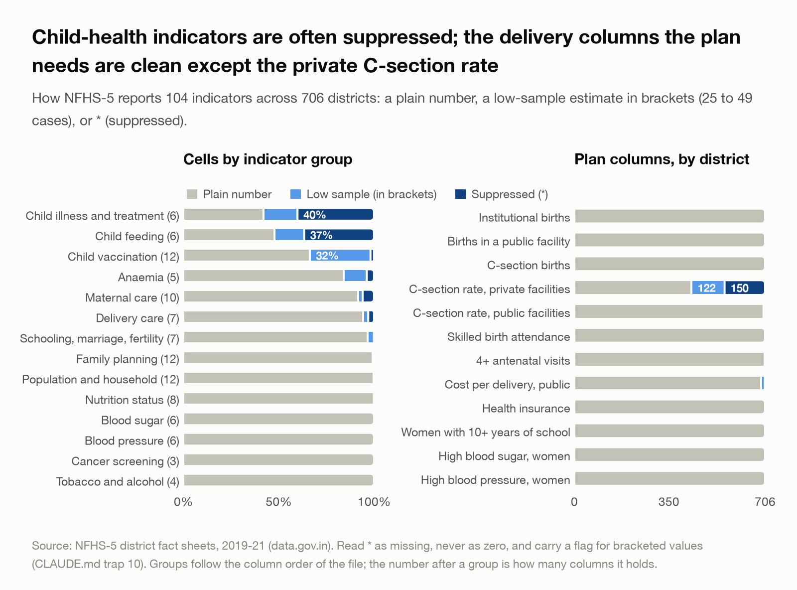

**Question.** How often are NFHS values suppressed or based on small samples, and does it affect the columns the plan uses?

**How.** The flag from `io.parse_nfhs_value` for every cell; `df[cols].stack().value_counts()` per group of columns (groups follow the column order of the file), and `(flags[col] == k).sum()` for each plan column.

**What it shows.** Of 73,424 indicator cells, 64,231 are plain numbers, 5,068 are low-sample estimates and 4,125 are suppressed. Child indicators are the worst: child illness and treatment 57.8% flagged, child feeding 52.1%, vaccination 33.6%. Adult blood sugar, blood pressure, screening and tobacco columns have no flags. The plan's delivery columns are clean except the private-facility C-section rate: 434 plain, 122 low-sample and 150 suppressed. Cost per delivery has 14 low-sample values and 1 suppressed.

**Caveat.** A low-sample value rests on 25 to 49 unweighted cases (the NFHS definition), so it is noisy, not wrong. Treat `*` as missing, never as zero.

**For the project.** Institutional births and public-facility births are safe targets. Do not use the private C-section rate as a target; if used as a feature, carry its flag.

## 12. Who is visible on the web?

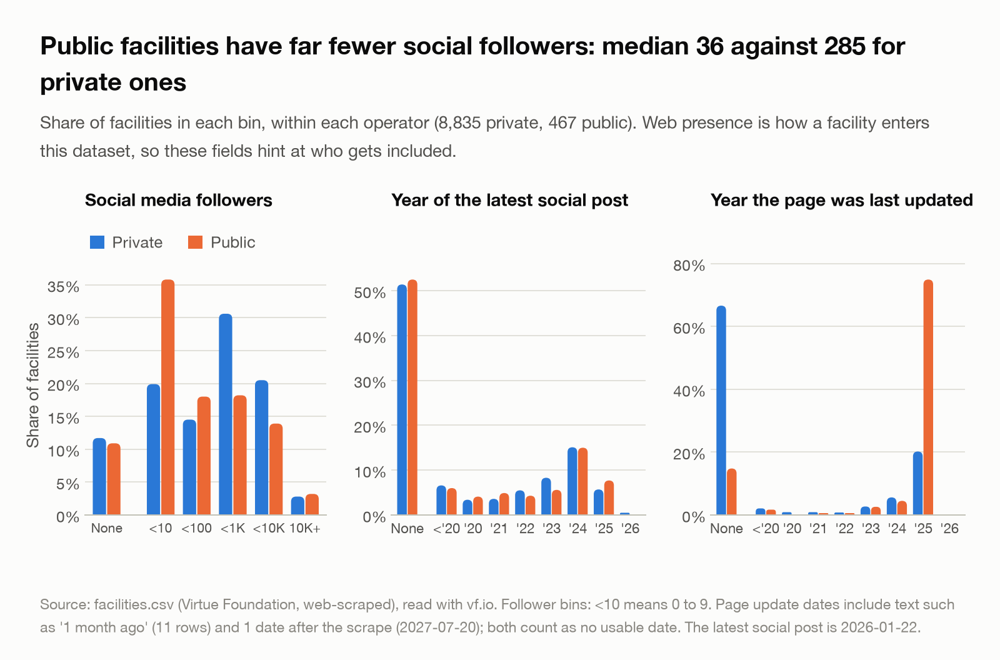

**Question.** Do public and private facilities leave the same web trail? Since the dataset is scraped from the web, this hints at who gets included.

**How.** `pd.cut` puts follower counts into bins; `pd.to_datetime(format="%Y-%m-%d", errors="coerce")` parses dates, turning anything else into missing; `value_counts(normalize=True)` within each operator gives shares that can be compared despite the very different group sizes.

**What it shows.** The median private facility has 285 followers and the median public one 36.5. About half of both groups have no social post date (51.4% private, 52.5% public), and few posted in 2025 or 2026 (6.2% and 7.7%). Page update dates go the other way: 66.6% of private facilities have none, but only 14.8% of public ones, and 74.9% of public facilities carry a 2025 date. The latest social post is 2026-01-22, which dates the scrape to about then.

**Caveat.** The inclusion process cannot be observed directly, and the page-update pattern does not fit a simple "public means less online" story; public pages may be government portals that carry a date. 11 page dates are text such as "1 month ago" or a bare year, and 1 (2027-07-20) is after the scrape.

**For the project.** Followers measure popularity, not quality, and they differ by operator. Using them in source confidence would push public facilities down; keep them out or adjust for operator.

## Traps found in this pass

These are new or sharper than the list in CLAUDE.md. Each number comes from the script.

1. The 11 duplicate `unique_id` rows are exact copies, so `drop_duplicates("unique_id")` is safe and gives 9,989 facilities.
2. Some PIN codes contain spaces ("411 001"). Stripping them gives 9,915 valid PINs instead of 9,762.
3. The India bounding box keeps bad post-office coordinates: a placeholder latitude 15.5934 on 695 offices, 1,085 offices more than 8 degrees from their state's median, and up to 348 offices on one identical point.
4. Fact arrays and `source_urls` are capped at 50 items per field.
5. Bed counts up to 200,000, doctor counts up to 15,000, and founding years of 0 exist.
6. `recency_of_page_update` mixes ISO dates with text ("1 month ago", bare years) and has a date in 2027.
7. NFHS `state_ut` has a leading space in 1 value and spells Maharashtra "Maharastra".
8. NFHS public-facility births are a share of all births, not of institutional births. Divide by institutional births to get the public share of facility births.
9. NFHS households surveyed is about the same in every district (median 908), so it is not a population weight.
10. The distinct-domain counts in `docs/02_data_dictionary.md` do not match a `urlparse`-based count; recheck before using domains for source confidence.
