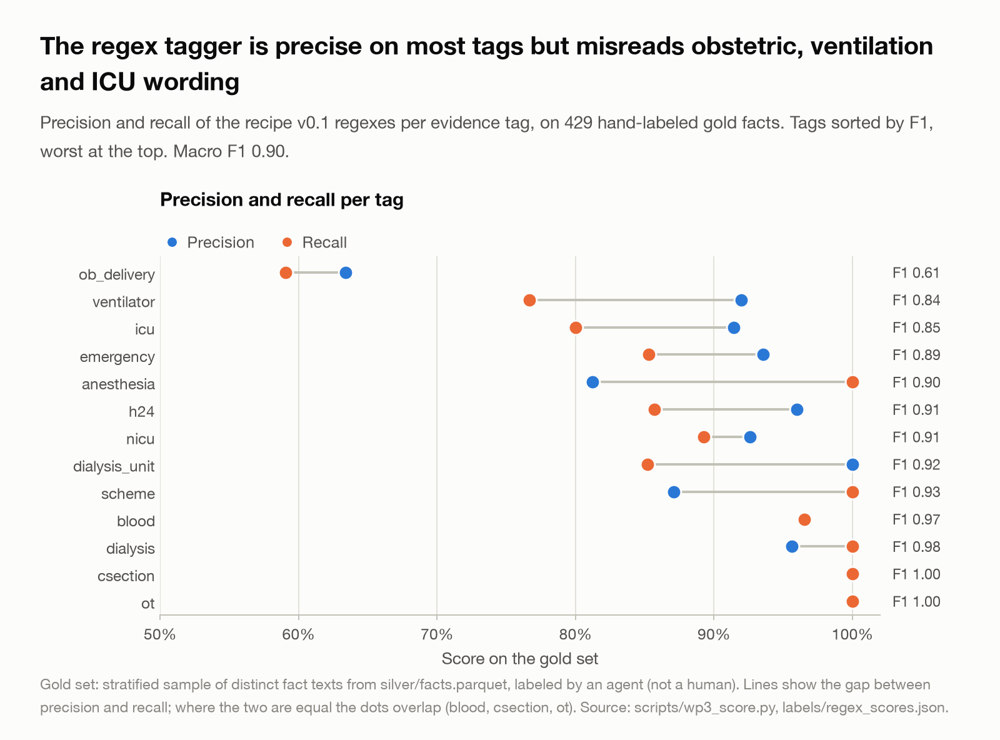

# Model A results: fact tagger

Model A gives each fact text zero or more evidence tags (recipe v0.1, `docs/06_capability_recipes.md`). This page scores each tagger against the hand-labeled gold set (`data/labels/gold_facts.csv`).

**The gold set is never used for training, prompt tuning, or choosing thresholds.** It only produces the numbers on this page. Teacher prompts and student models must be built without looking at it.

## Summary

The regex baseline reaches a macro F1 of 0.90 (95% interval 0.88 to 0.92) over the 13 evidence tags on 429 gold facts. 11 of 13 tags score 0.85 or more. The three weakest are `ob_delivery` (0.61), `ventilator` (0.84), `icu` (0.85). Their errors have plain causes (below) that a learned tagger should fix. The gold set over-draws regex matches and near misses on purpose, so these are rates on hard cases, not on a typical fact.

| Method | What it is | Macro precision | Macro recall | Macro F1 (95% CI) | Micro F1 | Exact match | Status |
| --- | --- | --- | --- | --- | --- | --- | --- |
| regex | recipe v0.1 regexes (src/vf/recipes.py) | 0.92 | 0.89 | 0.90 (0.88 to 0.92) | 0.89 | 0.81 | done |
| regex v0 | original patterns, before the v0.1 fixes | 0.87 | 0.90 | 0.88 (0.86 to 0.90) | 0.88 | 0.77 | superseded |
| teacher | LLM teacher labels (WP3 part 3) | pending | pending | pending | pending | pending | pending |
| student | trained student tagger (WP4) | pending | pending | pending | pending | pending | pending |

Macro averages weight each of the 13 evidence tags equally. Micro F1 pools every (fact, tag) decision. Exact match is the share of gold facts whose full evidence-tag set is predicted exactly. Intervals come from a stratified bootstrap (2,000 resamples within each sampling stratum).



## Per tag

| Tag | Gold positives | Regex precision | Regex recall | Regex F1 (95% CI) | Regex v0 F1 | Teacher F1 | Student F1 |
| --- | --- | --- | --- | --- | --- | --- | --- |
| `ob_delivery` | 44 | 0.63 (26/41) | 0.59 (26/44) | 0.61 (0.51 to 0.71) | 0.61 | pending | pending |
| `csection` | 26 | 1.00 (26/26) | 1.00 (26/26) | 1.00 (1.00 to 1.00) | 0.90 | pending | pending |
| `blood` | 29 | 0.97 (28/29) | 0.97 (28/29) | 0.97 (0.91 to 1.00) | 0.95 | pending | pending |
| `anesthesia` | 26 | 0.81 (26/32) | 1.00 (26/26) | 0.90 (0.80 to 0.97) | 0.90 | pending | pending |
| `ot` | 29 | 1.00 (29/29) | 1.00 (29/29) | 1.00 (1.00 to 1.00) | 1.00 | pending | pending |
| `h24` | 28 | 0.96 (24/25) | 0.86 (24/28) | 0.91 (0.82 to 0.98) | 0.95 | pending | pending |
| `nicu` | 28 | 0.93 (25/27) | 0.89 (25/28) | 0.91 (0.83 to 0.98) | 0.91 | pending | pending |
| `dialysis` | 44 | 0.96 (44/46) | 1.00 (44/44) | 0.98 (0.94 to 1.00) | 0.98 | pending | pending |
| `dialysis_unit` | 27 | 1.00 (23/23) | 0.85 (23/27) | 0.92 (0.85 to 0.98) | 0.80 | pending | pending |
| `icu` | 40 | 0.91 (32/35) | 0.80 (32/40) | 0.85 (0.77 to 0.93) | 0.84 | pending | pending |
| `ventilator` | 30 | 0.92 (23/25) | 0.77 (23/30) | 0.84 (0.75 to 0.91) | 0.84 | pending | pending |
| `emergency` | 34 | 0.94 (29/31) | 0.85 (29/34) | 0.89 (0.81 to 0.96) | 0.87 | pending | pending |
| `scheme` | 27 | 0.87 (27/31) | 1.00 (27/27) | 0.93 (0.86 to 0.98) | 0.93 | pending | pending |

Precision and recall show their counts in brackets. Most F1 intervals overlap, so the order of the middle tags is not reliable. Only `ob_delivery` has an F1 interval entirely below every other tag's. `csection` and `ot` made no errors on the gold set, so their intervals have zero width. That does not make them perfect; it means the sample found no error.

## What recipe v0.1 changed

Recipe v0.1 fixes four failure modes of v0 that changed facility grades (`docs/06_capability_recipes.md`, "Changes in v0.1"): a word boundary before "c section", VBAC wording ignored for `csection`, no `dialysis_unit` from "haemodialysis" alone, and no evidence tag on a fact with a negation or absence cue. On the gold set macro F1 moves from 0.88 to 0.90, and the tags whose F1 changed are `csection` (0.90 to 1.00), `blood` (0.95 to 0.97), `h24` (0.95 to 0.91), `dialysis_unit` (0.80 to 0.92), `icu` (0.84 to 0.85), `emergency` (0.87 to 0.89). Read this gain as optimistic: the failure modes were found in WP3 part 1 before the gold set was drawn, and the patterns were written from the full fact table, not tuned on gold scores, but the gold set over-samples exactly these failure modes, so it rewards their fix more than a random sample would. The negation cue costs `h24` recall: hedged statements such as "24x7 helpline (not listed? will not mention)" lose their tag. `h24` is a bonus tag and never changes a grade.

Errors of v0 that v0.1 fixes, with a gold example of each:

| Tag | Error fixed | Kind | Example from the gold set |
| --- | --- | --- | --- |
| `csection` | Word-internal 'c section' | false positive | "dedicated paediatric section" |
| `csection` | VBAC is a vaginal birth after a past caesarean | false positive | "provides vaginal birth after cesarean (vbac) services as a supported option" |
| `dialysis_unit` | 'Haemodialysis' alone counted as a named unit | false positive | "provides hemodialysis treatment" |
| `emergency` | Negation was not handled | false positive | "does not operate an emergency department" |

## Where the regex fails: the three worst tags

### `ob_delivery`: F1 0.61, precision 0.63, recall 0.59

Precision: the bare word 'obstetric' fires on specialty lists, department names and doctors' qualifications that never say the facility delivers babies. 14 of 15 false positives are texts where 'obstetric' is the only trigger. Recall: the gold set counts a caesarean as a delivery, and this pattern has no caesarean branch, so 16 of 18 misses are caesarean texts. The plural 'normal deliveries' also slips past 'normal delivery'. The caesarean misses change no EmOC grade, because a caesarean fact already gives grade 2. The false positives can lift a facility to grade 1 (claimed) with no delivery statement.

- False positive (regex tags it, gold does not): "obstetrics and gynecology department includes infertility treatment and gynecological laparoscopy."
- Missed (gold tags it, regex does not): "facilitates normal deliveries"

### `ventilator`: F1 0.84, precision 0.92, recall 0.77

Recall: the pattern needs the word 'ventilator' (or 'ventilatory'), so 'mechanical ventilation' and 'non-invasive ventilation' are missed (6 of 7 misses). Precision: it fires when ventilators are a stated need rather than equipment on hand, and on an ambiguous photo caption.

- Missed (gold tags it, regex does not): "non-invasive mechanical ventilation"
- False positive (regex tags it, gold does not): "need for monitors, ventilators, infusion pumps, and defibrillators to augment icu facilities"

### `icu`: F1 0.85, precision 0.91, recall 0.80

Recall: ICU types outside the pattern are missed: intensive cardiac care units (ICCU), intensive therapy units (ITU), PICU, and 'critical care' stated as a service offered. 8 of 8 misses are of this kind. Precision: 'intensive care' fires on a neonatal intensive care unit, which is nicu and not icu, and 'ICU' fires on an ICU ambulance and on a research statistic about ICU transfers (3 false positives in all, 1 of them NICU texts).

- Missed (gold tags it, regex does not): "has 14 itu beds"
- False positive (regex tags it, gold does not): "neonatal intensive care unit (nicu) level iii with 16 beds"

Other recurring errors (every error is listed in `data/labels/regex_scores.json`):

| Tag | Error | Kind | Example from the gold set |
| --- | --- | --- | --- |
| `dialysis_unit` | Unit words outside the list ('dialysis ward', 'dialysis clinic') | missed | "dialysis ward" |
| `h24` | The v0.1 negation cue drops a hedged statement the gold set counts | missed | "24x7 helpline (not listed? will not mention)" |
| `emergency` | Trauma rehabilitation is not emergency care | false positive | "major trauma rehabilitation" |
| `anesthesia` | Local or topical anaesthesia for a minor procedure | false positive | "cataract surgery performed under topical anesthesia with a 2.2 mm corneal incision" |
| `scheme` | 'Ayushman' as a hospital name | false positive | "ayushman hospital offers ivf and surrogacy services" |
| `emergency` | Ambulance services have no emergency word | missed | "provides ambulance facilities" |
| `h24` | Hyphenated 'round-the-clock' | missed | "round-the-clock community cancer care center" |

## Known failure modes, measured

Five strata were built from failure modes found in WP3 part 1. Inside each one, this is how often the targeted regex tag is right, for v0.1 and for v0. A stratum where the regex no longer fires shows no precision.

| Stratum | Distinct texts in data | Sampled | Tag checked | Regex fired | Right | Precision | v0 fired | v0 right | v0 precision |
| --- | --- | --- | --- | --- | --- | --- | --- | --- | --- |
| `fm_csection_wordpart` | 5 | 5 | csection | 0 | 0 |  | 5 | 0 | 0.00 |
| `fm_negation` | 77 | 14 | any evidence tag | 9 | 6 | 0.67 | 15 | 8 | 0.53 |
| `fm_haemodialysis_only` | 245 | 10 | dialysis_unit | 0 | 0 |  | 10 | 1 | 0.10 |
| `fm_neonatal_icu` | 644 | 10 | icu | 10 | 9 | 0.90 | 10 | 9 | 0.90 |
| `fm_obstetric_only` | 3,895 | 16 | ob_delivery | 16 | 2 | 0.12 | 16 | 2 | 0.12 |

- `fm_csection_wordpart`: regex tags csection but no real caesarean term (word-internal 'c section', e.g. 'paediatric section')
- `fm_negation`: regex tags something and a negation cue (\b(no|not|without|unavailable|lacks?|lacking|absence of|absent|neither|nor|never|non-availability|nil)\b) occurs within 40 characters of a regex match
- `fm_haemodialysis_only`: regex tags dialysis_unit only through h(a)emodialysis (no unit, machine, centre or nephrologist)
- `fm_neonatal_icu`: regex tags icu and the text has neonatal or paediatric intensive care words
- `fm_obstetric_only`: regex tags ob_delivery only through the word 'obstetric' (no maternity, labour room or ward, normal delivery, childbirth)

## Population estimates (regex)

Over all fact texts, the `ob_delivery` regex is mostly wrong: weighted precision is 0.33, so about 67% of the distinct texts it tags have no delivery statement, and 98% of those are texts where 'obstetric' (a specialty, department or doctor's title) is the only trigger. The ventilator regex finds an estimated 59% of ventilation texts. Weighting each gold fact by its stratum's population over sample size estimates the rates over all 275,095 distinct fact texts. Weighted macro F1 is 0.88 (95% interval 0.86 to 0.91). Treat these as rough. The random stratum has 30 texts standing for 208,276 texts with no regex tag and no near-miss word. It held 0 evidence positives, which bounds misses there only loosely. So weighted recall is an optimistic estimate, and the bootstrap cannot show that.

| Tag | Weighted precision | Weighted recall | Weighted F1 | Est. texts with the tag | Est. texts the regex tags |
| --- | --- | --- | --- | --- | --- |
| `ob_delivery` | 0.33 | 0.73 | 0.46 | 2,395 | 5,254 |
| `csection` | 1.00 | 1.00 | 1.00 | 537 | 537 |
| `blood` | 0.97 | 0.95 | 0.96 | 740 | 725 |
| `anesthesia` | 0.75 | 1.00 | 0.85 | 1,248 | 1,672 |
| `ot` | 1.00 | 1.00 | 1.00 | 2,853 | 2,853 |
| `h24` | 0.94 | 0.95 | 0.95 | 4,002 | 4,058 |
| `nicu` | 0.95 | 0.94 | 0.94 | 977 | 967 |
| `dialysis` | 0.95 | 1.00 | 0.98 | 1,633 | 1,717 |
| `dialysis_unit` | 1.00 | 0.82 | 0.90 | 838 | 690 |
| `icu` | 0.93 | 0.83 | 0.88 | 3,524 | 3,159 |
| `ventilator` | 0.92 | 0.59 | 0.72 | 787 | 501 |
| `emergency` | 0.90 | 0.86 | 0.88 | 6,877 | 6,577 |
| `scheme` | 0.91 | 1.00 | 0.95 | 879 | 962 |

## Gold set

- 429 distinct `text_norm` values from `silver/facts.parquet`, sampled by `scripts/wp3_gold_sample.py` (seed 20261121). There are 30 strata: five known failure modes, texts the regex tags (grouped by their rarest tag), regex-untagged near misses ("kidney", "critical", "round-the-clock", ...), and a random draw from everything else.
- Phase 2: after phase 1 (396 texts) was labeled, six tags had fewer than 25 positives. 33 more texts were drawn at random from those tags' strata (seed 20261122). Stratum weights use the combined sample sizes.
- Labeled by an agent (`labeled_by = agent`), one text at a time, from a blind worksheet. An agent-labeled gold set is weaker evidence than a human one. Hruday should spot-check it before the numbers go in the video, and the methods note must say who labeled it.
- Positives per evidence tag (all at least 25): `ob_delivery` 44, `csection` 26, `blood` 29, `anesthesia` 26, `ot` 29, `h24` 28, `nicu` 28, `dialysis` 44, `dialysis_unit` 27, `icu` 40, `ventilator` 30, `emergency` 34, `scheme` 27.
- Noise tags are labeled too, for scoring the teacher and student later: `reputation` 10, `location` 4, `staff_name` 13, `accessibility` 0, `photo_artifact` 7, `web_presence` 4, `other_clinical` 82. 28 texts have no tag at all.

Labeling rules:

- Each text is labeled by its meaning, from a blind worksheet that showed only the text (no stratum, no regex output).
- Negated, absent, referred-out, planned, historical, hypothetical and 'not specified in the content' statements get no evidence tag.
- A specialty word is not a service: 'Nephrology department' is not dialysis, 'Obstetrics and gynaecology' is not ob_delivery, and 'critical care' in a specialty or department list is not icu. The exception is anesthesiology, where the specialty is the service.
- ob_delivery needs a delivery, childbirth, labour or maternity word. A caesarean is a delivery, so csection texts also get ob_delivery.
- dialysis_unit needs a named dialysis unit, centre, ward or clinic, dialysis machines or equipment, or a nephrologist. 'Haemodialysis' alone is dialysis only.
- icu covers ICU, MICU, SICU, CCU, ICCU, PICU, RICU, ITU, intensive care, and critical care beds or services stated as provided. A NICU alone is nicu, not icu. An HDU is neither.
- ventilator covers ventilators and mechanical ventilation, invasive or non-invasive, when named as ventilation. CPAP, BiPAP or high-flow oxygen alone is not.
- anesthesia excludes local or topical anaesthesia as part of a minor, dental or eye procedure, dental sedation, and epidural steroid injections for pain.
- emergency covers emergency, casualty, trauma and ambulance services, of any kind. scheme covers public schemes only (Ayushman Bharat/PM-JAY, CGHS, ECHS, ESI, state schemes), not private insurers, TPAs, or 'Ayushman' as a hospital name.
- A name counts as a claim ('Sai Clinic & Maternity' gets ob_delivery). Photo captions get photo_artifact, plus an evidence tag only when the unit is unambiguous.
- Noise tags (reputation, location, staff_name, accessibility, photo_artifact, web_presence, other_clinical) are labeled too, but the regex has none, so they are not scored here.

## Caveats

- These are fact-level scores on distinct texts. They are not facility-level grade accuracy: one wrong fact can change a grade, and many grade-relevant errors cancel out across a facility's other facts.
- The gold set cannot see contamination (a fact about a different organization filed under this facility). That is a facility-linkage problem, not a text-tagging one.
- Several labels are judgment calls; each has a note in `gold_facts.csv`. The rules above are the ones the teacher prompt should state, so teacher and gold agree on definitions.

## Reproduce

```bash
.venv/bin/python scripts/wp3_gold_sample.py sample   # design only; labels come from the hand-labeled TSV
.venv/bin/python scripts/wp3_score.py
```

Generated by `scripts/wp3_score.py` on 2026-11-21 21:31 UTC.
