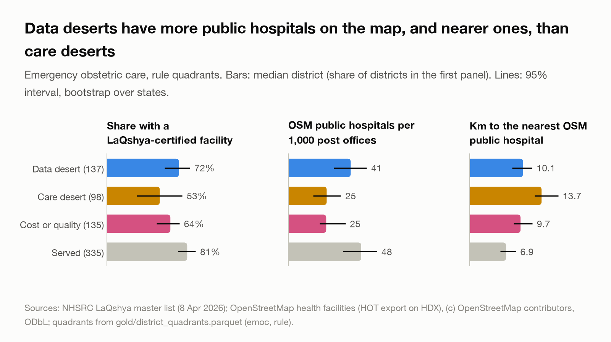
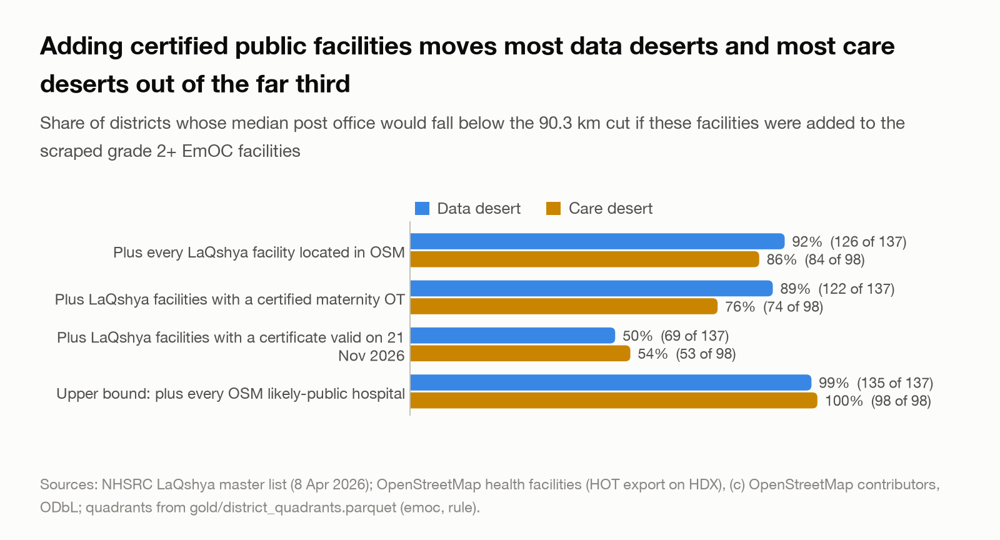
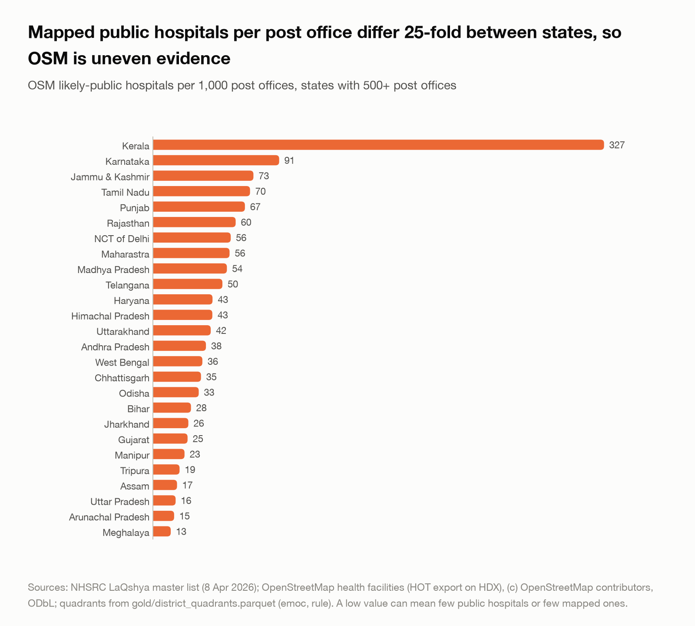

# WP2b: outside public-facility data as a check on the rule quadrants

Generated 2026-11-21T21:47:44Z by `scripts/wp2b_external.py`. Quadrants: `gold/district_quadrants.parquet` created 2026-11-21T21:32:59Z (stage `rule_only`, grades `regex`), service line emoc, 705 districts: 137 data deserts, 98 care deserts, 135 cost or quality, 335 served. Far third: median post office 90.3 km or more from a grade 2+ facility. OpenStreetMap source: HOT country export on HDX (Overpass was at capacity). Per decision D016 none of this feeds the quadrants; it only checks them and adds a side-by-side access layer.

## Findings

1. **OpenStreetMap: data deserts have nearer public hospitals than care deserts, and the gap holds inside states.** The median data-desert district has its typical post office 10.1 km from the nearest likely-public hospital on OSM, against 13.7 km in care deserts: -3.5 km (95% interval -6.7 to -1.8, bootstrap over states; Mann-Whitney p = 2.1e-07). Comparing districts of the same state the gap is -3.3 km (permutation p = 0.013, 14 states with both). Data deserts also have more of them: median 41 against 25 per 1,000 post offices, but within states that count gap is 3.8 (p = 0.27), so the count difference is mostly between states. The scraped table puts both groups equally far from grade 2+ care (medians 127 and 124 km), so this difference is information the quadrant rule did not have.
2. **LaQshya: data deserts more often have a certified public labour room or maternity OT, but only between states.** 72% of data deserts have at least one LaQshya-certified facility against 53% of care deserts (Mann-Whitney p = 0.0025); per 1,000 post offices the medians are 6.3 and 3.5 (difference 2.8, interval -2.5 to 9.0). Within states the share gap is -0.05 (p = 0.5): it does not hold. LaQshya certification follows state programmes (Madhya Pradesh, Karnataka, Tamil Nadu alone hold 37% of the certified facilities), and the quadrants are also state-clustered. Counting only certificates still valid on 21 Nov 2026: 29% against 18%.
3. **The stable cores agree, more strongly on OSM distance.** For the 68 data deserts and 45 care deserts that keep their label under all 16 threshold pairs: OSM public-hospital distance 10.1 against 14.2 km (within states -6.9 km, p = 9.0e-04, 8 states); share with a LaQshya facility 71% against 40% (interval for the difference -4 to 57 points; within states 0.02, p = 1). The brief's 69 and 46 came from an earlier quadrant run; the current file gives the counts above.
4. **Augmented access: the far third is mostly a blind spot for both groups, slightly more for data deserts.** Adding the 717 LaQshya facilities that could be placed on an OSM point to the scraped grade 2+ facilities, 126 of 137 data deserts (92%) and 84 of 98 care deserts (86%) fall below the 90.3 km cut. Median distance drops from 127 to 33 km in data deserts and from 124 to 43 km in care deserts. With maternity-OT-certified facilities only: 122 and 74. With certificates valid on 21 Nov 2026 only: 69 and 53. The difference between the two groups in who leaves is not significant within states (p = 0.21). If every OSM likely-public hospital counted (an upper bound: many cannot do a C-section), 135 and 98 would leave.
5. **What this does and does not support.** It supports the data-desert reading in one specific way: where the rule says "far from care, good outcomes", public hospitals are in fact nearer than where it says "far from care, poor outcomes", within the same state. It does not show that care deserts are far from public facilities: once certified public facilities are added, most care deserts leave the far third too (median 43 km against 33 km for data deserts). On this evidence the care-desert label rests partly on distance the scraped table cannot see, and poor outcomes there point at use, cost or quality as much as at distance. LaQshya presence does not separate the two groups within states.

## The test in numbers

Data desert against care desert, all districts. Median columns are medians over districts; the difference interval is a 95% bootstrap over states (2,000 draws, whole states resampled); within-state is the weighted mean over states of (data-desert mean minus care-desert mean), weights n_a n_b / (n_a + n_b), with a permutation p (10,000 shuffles of labels inside each state).

| measure | data desert | care desert | difference (95% interval) | Mann-Whitney p | within-state diff | p | states |
|---|---:|---:|---:|---:|---:|---:|---:|
| Has a LaQshya-certified facility (share of districts; columns are shares, not medians) | 0.72 | 0.53 | 0.19 (-0.03 to 0.42) | 0.0025 | -0.05 | 0.5 | 14 |
| Has one with a certificate valid on 21 Nov 2026 (share of districts) | 0.29 | 0.18 | 0.11 (-0.04 to 0.25) | 0.058 | 0.04 | 0.64 | 14 |
| LaQshya facilities per district | 1.0 | 1.0 | 0.0 (0.0 to 2.0) | 2.3e-05 | 0.2 | 0.31 | 14 |
| LaQshya facilities per 1,000 post offices | 6.3 | 3.5 | 2.8 (-2.5 to 9.0) | 0.051 | -0.9 | 0.54 | 14 |
| Valid-certificate facilities per 1,000 post offices | 0.0 | 0.0 | 0.0 (0.0 to 0.0) | 0.13 | -0.4 | 0.6 | 14 |
| OSM likely-public hospitals per district | 9.0 | 2.5 | 6.5 (2.0 to 10.0) | 1.7e-12 | 1.7 | 0.019 | 14 |
| OSM likely-public hospitals per 1,000 post offices | 41.0 | 25.2 | 15.8 (4.6 to 28.3) | 3.6e-06 | 3.8 | 0.27 | 14 |
| Median km to nearest OSM likely-public hospital | 10.1 | 13.7 | -3.5 (-6.7 to -1.8) | 2.1e-07 | -3.3 | 0.013 | 14 |
| Median km to nearest OSM public hospital named at FRU level | 21.6 | 21.7 | -0.0 (-8.2 to 8.0) | 0.89 | -7.9 | 6.0e-04 | 14 |
| Median km to nearest scraped grade 2+ EmOC facility (original) | 127.4 | 123.8 | 3.6 (-33.0 to 17.3) | 0.33 | 0.7 | 0.89 | 14 |

Stable cores only (68 data deserts, 45 care deserts):

| measure | data desert | care desert | difference (95% interval) | Mann-Whitney p | within-state diff | p | states |
|---|---:|---:|---:|---:|---:|---:|---:|
| Has a LaQshya-certified facility (share of districts; columns are shares, not medians) | 0.71 | 0.40 | 0.31 (-0.04 to 0.57) | 0.0013 | 0.02 | 1 | 8 |
| Has one with a certificate valid on 21 Nov 2026 (share of districts) | 0.28 | 0.09 | 0.19 (-0.00 to 0.34) | 0.014 | 0.22 | 0.058 | 8 |
| LaQshya facilities per district | 1.0 | 0.0 | 1.0 (0.0 to 2.0) | 1.5e-05 | 0.7 | 0.056 | 8 |
| LaQshya facilities per 1,000 post offices | 5.5 | 0.0 | 5.5 (-1.8 to 10.6) | 0.0047 | 1.8 | 0.57 | 8 |
| Valid-certificate facilities per 1,000 post offices | 0.0 | 0.0 | 0.0 (0.0 to 0.0) | 0.019 | 2.0 | 0.17 | 8 |
| OSM likely-public hospitals per district | 8.0 | 2.0 | 6.0 (2.0 to 11.0) | 2.2e-08 | 1.4 | 0.19 | 8 |
| OSM likely-public hospitals per 1,000 post offices | 43.5 | 23.8 | 19.7 (4.5 to 36.8) | 9.0e-04 | 1.2 | 0.81 | 8 |
| Median km to nearest OSM likely-public hospital | 10.1 | 14.2 | -4.1 (-9.4 to -1.6) | 1.7e-04 | -6.9 | 9.0e-04 | 8 |
| Median km to nearest OSM public hospital named at FRU level | 21.9 | 17.0 | 4.8 (-8.0 to 14.3) | 0.12 | -5.9 | 0.075 | 8 |
| Median km to nearest scraped grade 2+ EmOC facility (original) | 135.3 | 165.9 | -30.6 (-51.8 to 9.5) | 0.054 | -10.4 | 0.22 | 8 |

All four quadrants: Median km to nearest OSM likely-public hospital.

| quadrant | districts | median | 95% interval (states) | mean |
|---|---:|---:|---:|---:|
| Data desert | 137 | 10.1 | 8.1 to 11.9 | 15.5 |
| Care desert | 98 | 13.7 | 12.4 to 16.8 | 16.7 |
| Cost or quality | 135 | 9.7 | 8.3 to 11.9 | 10.8 |
| Served | 335 | 6.9 | 5.8 to 8.8 | 8.3 |

All four quadrants: OSM likely-public hospitals per 1,000 post offices.

| quadrant | districts | median | 95% interval (states) | mean |
|---|---:|---:|---:|---:|
| Data desert | 137 | 41.0 | 29.9 to 51.4 | 45.5 |
| Care desert | 98 | 25.2 | 16.2 to 34.5 | 29.8 |
| Cost or quality | 135 | 24.9 | 20.7 to 37.5 | 31.4 |
| Served | 335 | 47.9 | 35.9 to 58.1 | 69.6 |

All four quadrants: LaQshya facilities per 1,000 post offices.

| quadrant | districts | median | 95% interval (states) | mean |
|---|---:|---:|---:|---:|
| Data desert | 137 | 6.3 | 3.0 to 10.4 | 10.0 |
| Care desert | 98 | 3.5 | 0.0 to 9.3 | 7.5 |
| Cost or quality | 135 | 4.1 | 0.0 to 6.6 | 6.4 |
| Served | 335 | 6.7 | 4.9 to 9.1 | 10.3 |

Share of districts with at least one LaQshya-certified facility: Care desert 53%, Data desert 72%, Cost or quality 64%, Served 81%. With a certificate valid on 21 Nov 2026: Care desert 18%, Data desert 29%, Cost or quality 25%, Served 41%.

Augmented access (districts in the far third, 90.3 km, that would leave it):

| layer added to scraped grade 2+ EmOC | data deserts leaving | care deserts leaving | median km, data deserts (before, after) | median km, care deserts (before, after) | stable data deserts | stable care deserts |
|---|---:|---:|---:|---:|---:|---:|
| all LaQshya facilities located in OSM | 126 of 137 | 84 of 98 | 127, 33 | 124, 43 | 58 of 68 | 35 of 45 |
| LaQshya facilities with a maternity OT certificate | 122 of 137 | 74 of 98 | 127, 44 | 124, 56 | 56 of 68 | 30 of 45 |
| LaQshya facilities with a certificate valid on 21 Nov 2026 | 69 of 137 | 53 of 98 | 127, 89 | 124, 83 | 30 of 68 | 18 of 45 |
| every OSM likely-public hospital (upper bound) | 135 of 137 | 98 of 98 | 127, 10 | 124, 14 | 66 of 68 | 45 of 45 |

Districts in each quadrant with at least one LaQshya facility mapped to them: Care desert 52, Data desert 99, Cost or quality 86, Served 270. Spearman correlation across all districts between the original grade 2+ distance and the OSM public-hospital distance: rho = 0.44 (p = 1.7e-35).

Figures:

## Sources and match rates

**LaQshya master list** (NHSRC, dated 8 Apr 2026, 70 pages). Parsed 2,173 rows (serial numbers 1 to 2,173, none missing) into 1,261 facilities. Rows are facility by department: 1,229 labour room, 902 maternity OT, 42 with no department (a block of 2026 results at the end of the file). Status: 1,642 certified, 531 conditionally certified. Facility types: DH 1026, SDH 540, CHC 410, MC 197. Text overflowing a cell was repaired in 60 rows (state_overflow 32, type_overflow 22, department_overflow 6).

Expired certificates are kept and flagged, not dropped: 1,664 of 2,173 rows had a validity date before 21 Nov 2026 (retrieval), 1,376 before 8 Apr 2026 (the list date). 324 facilities hold at least one certificate valid on 21 Nov 2026 (517 on the list date).

District matching (rows): exact 1,814 (83.5%), fuzzy 232 (10.7%), manual 59 (2.7%), place 57 (2.6%), unmatched 11 (0.5%). Exact means equal, after normalising, to an NFHS district name or to a PIN-directory district name that the WP2 crosswalk maps to an NFHS district (this resolves post-2019 districts such as Tirupati or Eluru to their NFHS parent). Fuzzy means a name score of 85+ within the state, 5 points clear of any other district, same first letter unless the match is by word order or containment. Place means the district text, or a town in the facility name, equals the name of head or sub post offices that sit 70%+ in one district. Manual is a short reviewed list in the script (towns named as districts, misspellings).

Unmatched rows:

| S.No | state | district text | facility | reason |
|---:|---|---|---|---|
| 54 | Andhra Pradesh | Atmakur | DH Atmakur | no exact, fuzzy or place match |
| 280 | Delhi | (blank) | Deen Dayal Upadhyay Hospital | no exact, fuzzy or place match |
| 1269 | Mizoram | Saiha | DH Saiha | Saiha (Siaha) has no row in the project's NFHS file |
| 1270 | Mizoram | Saiha | DH Saiha | Saiha (Siaha) has no row in the project's NFHS file |
| 1449 | Rajasthan | Seoni | DH Seoni | no exact, fuzzy or place match |
| 2047 | West Bengal | Purba Bardhman | Barddhaman Medical College & Hospital | Purba Bardhaman has no row in the project's NFHS file |
| 2048 | West Bengal | Purba Bardhman | Barddhaman Medical College & Hospital | Purba Bardhaman has no row in the project's NFHS file |
| 2118 | West Bengal | Purba Bardhman | SDH Kalna | Purba Bardhaman has no row in the project's NFHS file |
| 2119 | West Bengal | Purba Bardhman | SDH Kalna | Purba Bardhaman has no row in the project's NFHS file |
| 2126 | West Bengal | Bardhaman | Sub Divisional Hospital Katwa | Katwa is in Purba Bardhaman, which has no row in the project's NFHS file |
| 2127 | West Bengal | Bardhaman | Sub Divisional Hospital Katwa | Katwa is in Purba Bardhaman, which has no row in the project's NFHS file |

Located on the map: 717 of 1261 facilities (57%) matched an OSM feature in the same district by place-name tokens (score 90+, OSM feature likely public or named with the facility's type; AYUSH, dispensary and similar names excluded). 537 are located only to their district and are left out of every distance; 7 have no district.

**OpenStreetMap** (HOT export). 117,774 features tagged amenity=hospital, clinic or doctors, or healthcare=hospital, clinic or centre, inside India (0 dropped outside the India box or without coordinates). Likely public: 24,944, of which 8,714 are hospitals (amenity or healthcare = hospital) and 2,278 of those are named at first-referral level (district, sub-district, sub-divisional, civil, taluk, area, sadar, rural or referral hospital, CHC or medical college, and not a PHC). 5,958 features carry operator:type. Rule counts (likely public):

| rule | features |
|---|---:|
| name contains 'PHC' | 8,889 |
| name contains 'Government' | 5,230 |
| name contains 'Primary Health Centre' | 3,344 |
| operator:type=government | 2,985 |
| name contains 'CHC' | 2,177 |
| name contains 'Community Health Centre' | 519 |
| name contains 'Rural Hospital' | 499 |
| name contains 'Civil Hospital' | 384 |
| name contains 'District Hospital' | 319 |
| name contains 'Medical College' | 194 |
| operator:type=public | 105 |
| name contains 'Sub Divisional Hospital' | 60 |
| name contains 'Sadar Hospital' | 58 |
| name contains 'Referral Hospital' | 56 |
| name contains 'Taluk Hospital' | 38 |
| name contains 'Area Hospital' | 38 |
| name:en contains 'Government' | 18 |
| operator:type=public; government | 6 |
| operator:type=government_facility-public | 5 |
| operator:type=public;government | 5 |

District: nearest geocoded, non-suspect post office. Distance to it: median 0.72 km, 90th percentile 3.71 km, maximum 58.64 km.

**Census 2011 population** (Hugging Face indiaset/census-2011, CC-BY-4.0). 640 census districts: exact 635, fuzzy 4, unmatched 1 by name. Unmatched: Saiha (Mizoram, 56,574). NFHS districts: census_name_exact 588, parent_split_by_post_offices 113, census_name_fuzzy 4; 113 values are estimates (is_estimate = true). The parent of each of the 66 NFHS districts created after 2011 was chosen by a vote of nearest post offices; 37 votes were under 60%, and spot checks found wrong parents (Hojai was given Udalguri instead of Nagaon; West Karbi Anglong was given Cachar instead of Karbi Anglong; Suryapet was given Khammam instead of Nalgonda; Siddipet was given Karimnagar, though most of it came from Medak). The vote fails where the PIN directory files offices under the wrong district, and post-office counts are a weak proxy for people. Treat every split value as rough until a reviewed parent list replaces the vote; the 592 unsplit values are Census 2011 totals (or sums of them). The table was not finished to that standard within the time box and is not used in the validation, which normalises by post offices.

## Method

- LaQshya PDF: pdfplumber finds the table grid; each row's characters are read in content-stream order and cut into text runs, and a whole run goes to the cell where it starts. Long names overflow into the next column, so position alone interleaves two cells ("Vishakhapatna" + "mCHC"). Remaining overflows (state into district, district into type, department into name) are undone with the closed lists of states, types and departments.
- A facility is one id per district and core name (the name without generic words such as hospital, district, CHC, govt), so the labour-room and OT rows of one hospital count once; type must agree (DH and SDH may mix).
- OSM likely-public flag, in order: operator:type government, public, state, military, municipal or national is public; private, NGO, religious and similar is not; otherwise the first name marker found in name, name:en or operator (Government, Govt, District Hospital, Sub District Hospital, Sub Divisional Hospital, Community Health Centre, CHC, Primary Health Centre, PHC, Civil Hospital, Medical College, and the additions Taluk, Area, Sadar, Rural and Referral Hospital), unless the same field says Pvt, Private, Ltd or Nursing Home. `public_rule` records which rule fired for every row.
- Distances: straight line, BallTree haversine, from every geocoded, non-suspect post office with a district (WP5's rollup: offices stacked on one placeholder point count once per district), to the nearest target anywhere in India. District value = median over its offices. Augmented distance per office = min(original grade 2+ distance from `post_office_access`, distance to the nearest located LaQshya facility), which is the nearest of the union.
- Check: the original grade 2+ medians recomputed this way match `district_access` (emoc, min_grade 2) to within 0.000 km in every district.
- Stability: same label under all 16 threshold pairs, recomputed from the cut values in the quadrants meta; used only because it reproduces the meta's published counts exactly.

## Caveats

- OSM completeness varies by state (figure 3). A district with few mapped public hospitals may have many unmapped. The within-state comparisons exist to blunt this, not remove it.
- The public-name rule is crude. "Medical College" also matches private colleges; a government hospital named after a person without a marker is missed; PHCs tagged as hospitals count as hospitals. The first-referral subset (no PHC names) does not separate the groups overall (medians 21.6 and 21.7 km) but does within states (-7.9 km, p = 6.0e-04), so part of the overall OSM gap comes from PHCs.
- LaQshya lists certified facilities only. Absence means not certified, not no care. Certification follows state programme intensity, which is why the between-state gap disappears within states.
- About 43% of LaQshya facilities could not be placed on an OSM point and are excluded from augmented distances, so the augmented layer understates access; a few name matches may land on a same-town facility rather than the certified one, an error of a few km.
- Upstream gold tables are being regenerated by other work packages. These numbers use the quadrants file created 2026-11-21T21:32:59Z; rerun the script after any upstream change.
- What the OSM test can and cannot tell apart: nearer public hospitals in data deserts is what a blind facility table predicts, and it is also what one expects if nearby public hospitals raise institutional births. Both readings say the scraped distance understates access in data deserts; neither is ruled out here.
- Straight-line distance, not travel time.

## Files

- `data/silver/ext_laqshya.parquet`, `data/silver/ext_osm_health.parquet`, `data/silver/ext_district_population.parquet` (each with `.meta.json`)
- `data/external/SOURCES.md` and the raw downloads beside it (with `.source.json` sidecars)
- `reports/figures/wp2b_*.png`
